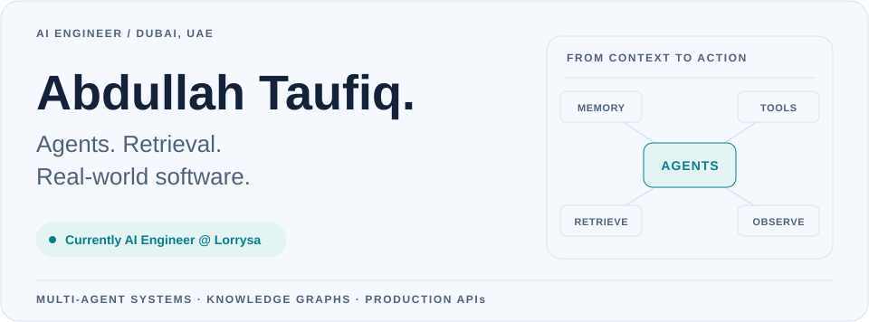
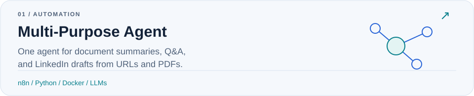
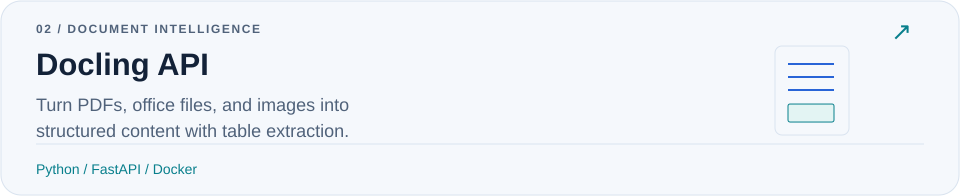
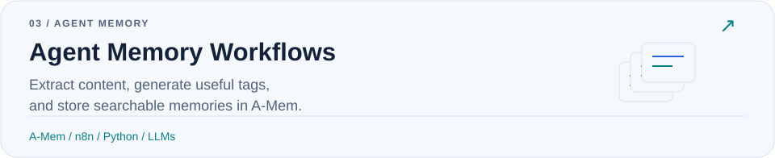

<a href="https://abdullah91111.github.io/portfolio/">
  <picture>
    <source media="(max-width: 600px) and (prefers-color-scheme: dark)" srcset="assets/hero-mobile-dark.svg">
    <source media="(max-width: 600px)" srcset="assets/hero-mobile-light.svg">
    <source media="(prefers-color-scheme: dark)" srcset="assets/hero-dark.svg">
    
  </picture>
</a>

  <a href="https://abdullah91111.github.io/portfolio/"><b>Portfolio ↗</b></a> &nbsp;·&nbsp;
  <a href="https://www.linkedin.com/in/abdullah-taufiq-5975b4171/"><b>LinkedIn ↗</b></a> &nbsp;·&nbsp;
  <a href="mailto:taufiq44@hotmail.com"><b>Email ↗</b></a> &nbsp;·&nbsp;
  <a href="https://leetcode.com/u/Abdullah91111/"><b>LeetCode ↗</b></a>

I build AI applications that work with real context: **multi-agent systems, persistent memory, RAG, and knowledge graphs**. My work connects agent orchestration and retrieval with production APIs, automation, and observability.

I'm currently an **AI Engineer at [Lorrysa](https://lorrysa.com)**, working on connected web, backend, and driver app experiences for logistics and delivery management.

## Experience

<table>
  <tr>
    <td width="72" align="center" valign="top"></td>
    <td>
      <strong>Lorrysa · AI Engineer</strong> 
      August 2026 – Present · Current role  
      Working on Lorrysa's logistics and delivery management platform, connecting web, backend, and driver apps for trip management, live tracking, and delivery workflows.  
      <code>Next.js</code> <code>TypeScript</code> <code>Go</code> <code>Flutter</code> <code>Google Maps</code>
    </td>
  </tr>
  <tr>
    <td width="72" align="center" valign="top"></td>
    <td>
      <strong>BrainyAI · AI Engineer</strong> 
      February 2025 – June 2026 · Dubai, UAE  
      Built multi-agent workflows with tool calling, streaming, and persistent memory. Combined vector search and knowledge graphs for retrieval, automated workflows with n8n, and added observability for production AI systems.  
      <code>Python</code> <code>LangChain</code> <code>Letta</code> <code>Neo4j</code> <code>FalkorDB</code> <code>Qdrant</code> <code>n8n</code>
    </td>
  </tr>
  <tr>
    <td width="72" align="center" valign="top"></td>
    <td>
      <strong>PureCS · AI Intern</strong> 
      August – September 2024 · Dubai, UAE  
      Explored retrieval-augmented generation for document-driven applications and researched chunking strategies to improve the context retrieved for LLMs.  
      <code>Python</code> <code>RAG</code> <code>LLMs</code> <code>Document processing</code>
    </td>
  </tr>
</table>

<b>Earlier experience & education</b>

- **Pure Health · Customer Service Team Lead** — September 2020–April 2022, Dubai Airports, UAE. Led a frontline team focused on resolution quality, team performance, and dependable customer experiences.
- **Swinburne University of Technology** — BSc Computer Science, Artificial Intelligence · 2021–2024 · Sarawak, Malaysia.

[Full experience →](https://abdullah91111.github.io/portfolio/experience/)

## Selected projects

A few things I've built around useful agents, structured documents, and memory. Open a card to explore the code.

<a href="https://github.com/abdullah91111/Multi-Purpose-Agent-in-n8n">
  <picture>
    <source media="(max-width: 600px) and (prefers-color-scheme: dark)" srcset="assets/project-agent-mobile-dark.svg">
    <source media="(max-width: 600px)" srcset="assets/project-agent-mobile-light.svg">
    <source media="(prefers-color-scheme: dark)" srcset="assets/project-agent-dark.svg">
    
  </picture>
</a>

<a href="https://github.com/abdullah91111/docling-api">
  <picture>
    <source media="(max-width: 600px) and (prefers-color-scheme: dark)" srcset="assets/project-docling-mobile-dark.svg">
    <source media="(max-width: 600px)" srcset="assets/project-docling-mobile-light.svg">
    <source media="(prefers-color-scheme: dark)" srcset="assets/project-docling-dark.svg">
    
  </picture>
</a>

<a href="https://github.com/abdullah91111/Create-and-Search-Memories-for-A-mem-using-n8n">
  <picture>
    <source media="(max-width: 600px) and (prefers-color-scheme: dark)" srcset="assets/project-memory-mobile-dark.svg">
    <source media="(max-width: 600px)" srcset="assets/project-memory-mobile-light.svg">
    <source media="(prefers-color-scheme: dark)" srcset="assets/project-memory-dark.svg">
    
  </picture>
</a>

[More on my portfolio →](https://abdullah91111.github.io/portfolio/projects/)

## Tools I work with

| Area | Stack |
| :--- | :--- |
| **Languages & applications** | Python · TypeScript · JavaScript · SQL · Go · Next.js · Flutter |
| **Agents & retrieval** | LangChain · LangGraph · Letta · RAG · GraphRAG · n8n |
| **Graphs & storage** | Neo4j · FalkorDB · Qdrant · FAISS · Redis · Supabase |
| **APIs & infrastructure** | FastAPI · Pydantic · REST APIs · Docker · GitHub Actions · Azure |
| **ML & observability** | PyTorch · scikit-learn · Pandas · NumPy · MLflow · Datadog · PostHog |

## A year of contributions, one bite at a time

<picture>
  <source media="(prefers-color-scheme: dark)" srcset="https://raw.githubusercontent.com/abdullah91111/abdullah91111/output/github-snake-dark.svg">
  
</picture>

Generated daily from my GitHub contributions with <a href="https://github.com/Platane/snk">snk</a>.

---

Interested in **agents, retrieval, or production AI**? I'd love to exchange ideas or collaborate.

  <a href="mailto:taufiq44@hotmail.com"><b>Let's talk ↗</b></a> &nbsp;·&nbsp;
  <a href="https://abdullah91111.github.io/portfolio/">Explore my portfolio</a> &nbsp;·&nbsp;
  <a href="https://www.linkedin.com/in/abdullah-taufiq-5975b4171/">Connect on LinkedIn</a>

