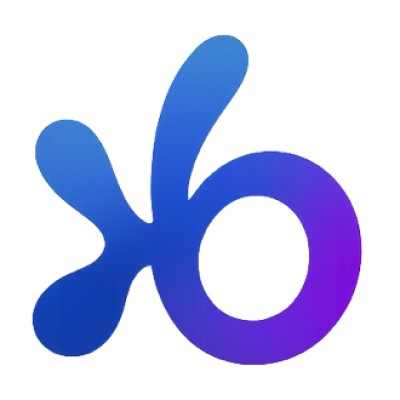
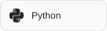
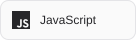
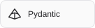
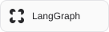
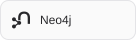
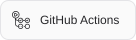
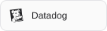
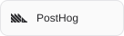

<a href="https://abdullah91111.github.io/portfolio/">
  <picture>
    <source media="(prefers-color-scheme: dark)" srcset="assets/portfolio-banner-dark.svg">
    
  </picture>
</a>

# Abdullah Taufiq

**AI Engineer · Dubai, UAE**

I build agents, retrieval pipelines, and knowledge systems.

- Currently at **[Lorrysa](https://lorrysa.com)**, working on its logistics and delivery management platform.
- Previously at **BrainyAI**, building the orchestration, retrieval, and observability around production AI.
- I enjoy turning complex systems into useful, understandable products.

[Portfolio](https://abdullah91111.github.io/portfolio/) · [LinkedIn](https://www.linkedin.com/in/abdullah-taufiq-5975b4171/) · [Email](mailto:taufiq44@hotmail.com) · [LeetCode](https://leetcode.com/u/Abdullah91111/)

## Experience

<table>
  <tr>
    <td width="72" align="center" valign="top"></td>
    <td>
      <strong>Lorrysa · AI Engineer</strong> 
      August 2026 – Present ·   
      Working on Lorrysa's logistics and delivery management platform, connecting web, backend, and driver apps for trip management, live tracking, and delivery workflows.  
      <code>Next.js</code> <code>TypeScript</code> <code>Go</code> <code>Flutter</code> <code>Google Maps</code>
    </td>
  </tr>
  <tr>
    <td width="72" align="center" valign="top"></td>
    <td>
      <strong>BrainyAI · AI Engineer</strong> 
      February 2025 – June 2026 · Dubai, UAE  
      Built multi-agent workflows with tool calling, streaming, and persistent memory. Combined vector search and knowledge graphs for retrieval, automated workflows with n8n, and added observability for production AI systems.  
      <code>Python</code> <code>LangChain</code> <code>Letta</code> <code>Neo4j</code> <code>FalkorDB</code> <code>Qdrant</code> <code>n8n</code>
    </td>
  </tr>
  <tr>
    <td width="72" align="center" valign="top"></td>
    <td>
      <strong>PureCS · AI Intern</strong> 
      August – September 2024 · Dubai, UAE  
      Explored retrieval-augmented generation for document-driven applications and researched chunking strategies to improve the context retrieved for LLMs.  
      <code>Python</code> <code>RAG</code> <code>LLMs</code> <code>Document processing</code>
    </td>
  </tr>
</table>

<b>Earlier experience & education</b>

- **Pure Health · Customer Service Team Lead** — September 2020–April 2022, Dubai Airports, UAE. Led a frontline team focused on resolution quality, team performance, and dependable customer experiences.
- **Swinburne University of Technology** — BSc Computer Science, Artificial Intelligence · 2021–2024 · Sarawak, Malaysia.

[Full experience →](https://abdullah91111.github.io/portfolio/experience/)

## Selected projects

### [Multi-Purpose Agent](https://github.com/abdullah91111/Multi-Purpose-Agent-in-n8n)

An n8n agent for document summaries, question answering, and LinkedIn drafts from URLs and PDFs.

`n8n` `Python` `Docker` `LLMs`

### [Docling API](https://github.com/abdullah91111/docling-api)

Converts PDFs, office files, and images into structured content, with table extraction and Markdown, JSON, and HTML exports.

`Python` `FastAPI` `Docker`

### [Agent Memory Workflows](https://github.com/abdullah91111/Create-and-Search-Memories-for-A-mem-using-n8n)

Workflows that extract content from URLs and PDFs, generate AI tags, and store searchable memories in A-Mem.

`A-Mem` `n8n` `Python` `LLMs`

[More projects on my portfolio](https://abdullah91111.github.io/portfolio/projects/)

## Tools I work with

  <b>LANGUAGES</b>  
  <picture>
    <source media="(prefers-color-scheme: dark)" srcset="assets/tech/python-dark.svg">
    
  </picture>
  <picture>
    <source media="(prefers-color-scheme: dark)" srcset="assets/tech/typescript-dark.svg">
    
  </picture>
  <picture>
    <source media="(prefers-color-scheme: dark)" srcset="assets/tech/javascript-dark.svg">
    
  </picture>
  <picture>
    <source media="(prefers-color-scheme: dark)" srcset="assets/tech/go-dark.svg">
    
  </picture>
  <picture>
    <source media="(prefers-color-scheme: dark)" srcset="assets/tech/postgresql-dark.svg">
    
  </picture>

  <b>APPLICATIONS &amp; APIS</b>  
  <picture>
    <source media="(prefers-color-scheme: dark)" srcset="assets/tech/nextdotjs-dark.svg">
    
  </picture>
  <picture>
    <source media="(prefers-color-scheme: dark)" srcset="assets/tech/flutter-dark.svg">
    
  </picture>
  <picture>
    <source media="(prefers-color-scheme: dark)" srcset="assets/tech/fastapi-dark.svg">
    
  </picture>
  <picture>
    <source media="(prefers-color-scheme: dark)" srcset="assets/tech/pydantic-dark.svg">
    
  </picture>

  <b>AGENTS &amp; RETRIEVAL</b>  
  <picture>
    <source media="(prefers-color-scheme: dark)" srcset="assets/tech/langchain-dark.svg">
    
  </picture>
  <picture>
    <source media="(prefers-color-scheme: dark)" srcset="assets/tech/langgraph-dark.svg">
    
  </picture>
  <picture>
    <source media="(prefers-color-scheme: dark)" srcset="assets/tech/n8n-dark.svg">
    
  </picture>
  <picture>
    <source media="(prefers-color-scheme: dark)" srcset="assets/tech/letta-dark.svg">
    
  </picture>
  <picture>
    <source media="(prefers-color-scheme: dark)" srcset="assets/tech/rag-dark.svg">
    
  </picture>
  <picture>
    <source media="(prefers-color-scheme: dark)" srcset="assets/tech/graphrag-dark.svg">
    
  </picture>

  <b>GRAPHS &amp; STORAGE</b>  
  <picture>
    <source media="(prefers-color-scheme: dark)" srcset="assets/tech/neo4j-dark.svg">
    
  </picture>
  <picture>
    <source media="(prefers-color-scheme: dark)" srcset="assets/tech/qdrant-dark.svg">
    
  </picture>
  <picture>
    <source media="(prefers-color-scheme: dark)" srcset="assets/tech/redis-dark.svg">
    
  </picture>
  <picture>
    <source media="(prefers-color-scheme: dark)" srcset="assets/tech/supabase-dark.svg">
    
  </picture>
  <picture>
    <source media="(prefers-color-scheme: dark)" srcset="assets/tech/falkordb-dark.svg">
    
  </picture>
  <picture>
    <source media="(prefers-color-scheme: dark)" srcset="assets/tech/faiss-dark.svg">
    
  </picture>

  <b>MACHINE LEARNING</b>  
  <picture>
    <source media="(prefers-color-scheme: dark)" srcset="assets/tech/pytorch-dark.svg">
    
  </picture>
  <picture>
    <source media="(prefers-color-scheme: dark)" srcset="assets/tech/scikitlearn-dark.svg">
    
  </picture>
  <picture>
    <source media="(prefers-color-scheme: dark)" srcset="assets/tech/pandas-dark.svg">
    
  </picture>
  <picture>
    <source media="(prefers-color-scheme: dark)" srcset="assets/tech/numpy-dark.svg">
    
  </picture>

  <b>INFRA &amp; OBSERVABILITY</b>  
  <picture>
    <source media="(prefers-color-scheme: dark)" srcset="assets/tech/docker-dark.svg">
    
  </picture>
  <picture>
    <source media="(prefers-color-scheme: dark)" srcset="assets/tech/githubactions-dark.svg">
    
  </picture>
  <picture>
    <source media="(prefers-color-scheme: dark)" srcset="assets/tech/mlflow-dark.svg">
    
  </picture>
  <picture>
    <source media="(prefers-color-scheme: dark)" srcset="assets/tech/datadog-dark.svg">
    
  </picture>
  <picture>
    <source media="(prefers-color-scheme: dark)" srcset="assets/tech/posthog-dark.svg">
    
  </picture>
  <picture>
    <source media="(prefers-color-scheme: dark)" srcset="assets/tech/azure-dark.svg">
    
  </picture>

## GitHub activity

<picture>
  <source media="(prefers-color-scheme: dark)" srcset="https://raw.githubusercontent.com/abdullah91111/abdullah91111/output/github-snake-dark.svg">
  
</picture>

Generated daily from my GitHub contributions with <a href="https://github.com/Platane/snk">snk</a>.

---

Interested in **agents, retrieval, or production AI**? I'd love to exchange ideas or collaborate.

  <a href="mailto:taufiq44@hotmail.com"><b>Let's talk</b></a> &nbsp;·&nbsp;
  <a href="https://abdullah91111.github.io/portfolio/">Explore my portfolio</a> &nbsp;·&nbsp;
  <a href="https://www.linkedin.com/in/abdullah-taufiq-5975b4171/">Connect on LinkedIn</a>

